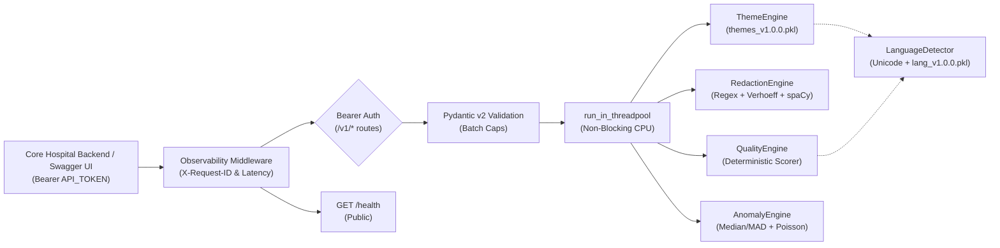

# `comment-insights-api`

[](https://www.python.org/)
[](https://fastapi.tiangolo.com/)
[](https://www.docker.com/)
[](#testing--evaluation)
[](#verification-scorecard)

A **stateless, CPU-optimized Python & FastAPI NLP microservice** for multilingual healthcare patient feedback analytics. Designed to sit behind a core hospital platform, it processes raw patient comments in real time—returning complaint themes, redacted text, usefulness scores, language tags, and department spike alerts—with zero database persistence and zero external LLM API costs.

---

## Key Capabilities

1. **Multilingual Complaint Theme Tagging (`POST /v1/themes`):** Multi-label classification across 11 hospital complaint categories with NLTK + contrast-clause splitting so complaints inside mixed praise (*"Doctor was great, but pharmacy took 2 hours"*) are never missed.
2. **Regional PII Redaction (`POST /v1/redact`):** Hybrid Regex + Verhoeff checksum + `spaCy` NER engine masking names, India/UAE/Saudi phone numbers, emails, MRN/UHIDs, Emirates IDs, Iqama numbers, and Aadhaar numbers while protecting ordinary hospital terms (`OPD`, `Room 304`, `INV-884210`).
3. **Scored Comment Quality Filter (`POST /v1/comment-quality`):** Deterministic rule cascade filtering junk (`""`, `"ok"`, `"nil"`, `"12345"`, `"asdfghjkl"`, lone emojis) and scoring actionable feedback (`0.0–1.0`).
4. **Department Spike & Anomaly Alerts (`POST /v1/anomalies`):** Day-type stratified rolling **Median + MAD** detector (28-day weekdays vs. 56-day Sundays) with a **Poisson upper-tail guard** for low-volume departments and automatic `skippedSeries` reporting for short histories (`< 14` days).
5. **5-Language Detection (Integrated):** Instant Unicode script routing (`ml`, `hi`, `ar`) combined with a trained ML classifier (`lang_v1.0.0.pkl`) separating Latin-script English (`en`) from Manglish (`manglish`).
6. **Production Engineering Essentials:** Mandatory Bearer token auth, `/health` model metadata, non-blocking `run_in_threadpool` CPU offload, `X-Request-ID` & `X-Process-Time-Ms` tracing headers, 23 `pytest` tests, and a hardened non-root Docker container.

---

## System Architecture



---

## Tools & Tech Stack

| Category | Tools & Libraries | Role in System |
| :--- | :--- | :--- |
| **Core Runtime** | Python `3.13.3` | Runtime environment aligned across local dev, `.pkl` artifacts, and Docker |
| **API & Serving** | FastAPI, Uvicorn, Starlette, Pydantic v2 | Async REST routing, Swagger UI (`/docs`), threadpool offload, strict schema validation |
| **Machine Learning** | `scikit-learn`, `joblib`, NumPy | TF-IDF + multi-label probability pipelines, threshold calibration, Median/MAD & Poisson math |
| **NLP & Entity Extraction** | `spaCy` (`en_core_web_sm`), NLTK (`punkt_tab`) | `PERSON` Named Entity Recognition, sentence & clause tokenization |
| **Testing & QA** | `pytest`, `httpx` / `TestClient` | 23 automated unit, auth, startup-guard, and edge-case integration tests |
| **Containerization** | Docker (`python:3.13-slim`), `HEALTHCHECK` | Patched, offline-booting, non-root (`appuser`) production image |
| **Data Utilities** | `openpyxl` / `pandas` (`scripts/excel_to_csv.py`) | Offline Excel-to-CSV preparation (header detection & merged-cell forward-fill) |

---

## Verification Scorecard

All 6 tasks pass their target benchmarks on held-out synthetic test suites:

| Task | Evaluation Command | Target | Achieved | Status |
| :--- | :--- | :--- | :--- | :---: |
| **Task 1: Themes** | `python eval/eval_themes.py --csv data/heldout/themes_test_300.csv` | Macro-F1 $\ge 0.750$ | **Macro-F1 = `0.767`** (Micro-F1 = `0.798`) | **PASS** |
| **Task 2: PII Redaction** | `python eval/eval_redact.py --csv data/heldout/redact_test_500.csv` | Recall $\ge 98\%$, FA $< 2\%$ | **Recall = `99.13%`**, **FA = `0.15%`** | **PASS** |
| **Task 3: Quality Filter** | `python eval/eval_quality.py --csv data/heldout/quality_test_200.csv` | Full rule coverage | **Acc = `100.00%`**, **FA = `0.00%`** | **PASS** |
| **Task 4: Spike Alerts** | `python eval/eval_anomalies.py --csv data/heldout/anomalies_test_1080.csv` | Recall $\ge 90\%$, FA/90d $\le 1.0$ | **Recall = `100.00%`** (`20/20`), **FA/90d = `0.68`** | **PASS** |
| **Task 5: Language** | `python eval/eval_language.py --csv data/heldout/language_test_250.csv` | Accuracy $\ge 95.00\%$ | **Accuracy = `100.00%`** (`250/250`) | **PASS** |
| **Task 6: Engineering** | `python -m pytest -v` + Docker build/run | All tests & container pass | **`23/23` passed**, container healthy | **PASS** |

---

## Repository Structure

```text
comment-insights-api/
├── app/
│   ├── main.py           # FastAPI app, lifespan model loading, middleware, routes
│   ├── auth.py           # Mandatory Bearer API_TOKEN guard & startup validation
│   ├── schemas.py        # Pydantic v2 request/response contracts & batch limits
│   ├── constants.py      # 11 canonical themes & shared constants
│   ├── text_utils.py     # Hospital emoji/slang normalization & clause splitting
│   ├── language.py       # Unicode script router + English/Manglish ML classifier
│   ├── themes.py         # Multi-label ThemeEngine (max-pooling across clauses)
│   ├── redact.py         # Hybrid Regex + Verhoeff checksum + spaCy NER engine
│   ├── quality.py        # Deterministic junk filter & qualityScore calculator
│   └── anomalies.py      # Day-type Median/MAD + Poisson spike detector
├── generators/           # Synthetic training & held-out dataset generators (gen_*.py)
├── training/             # Offline ML trainers (train_themes.py, train_lang.py)
├── models/               # Versioned production artifacts (themes_v1.0.0.pkl, lang_v1.0.0.pkl)
├── eval/                 # Standalone CLI evaluation harnesses (eval_*.py)
├── scripts/              # Offline utilities (excel_to_csv.py)
├── tests/                # Automated pytest suite (test_api.py)
├── Dockerfile            # Hardened python:3.13-slim non-root container
└── requirements.txt      # Pinned Python dependencies
```

---

## Quick Start

### Option 1: Run with Docker (Recommended)

```powershell
docker build -t comment-insights-api .
docker run -d --rm --name comment-insights-api -p 8000:8000 -e API_TOKEN=dev-secret-token comment-insights-api
```

Open **`http://localhost:8000`** in your browser (automatically redirects to Swagger UI at `/docs`). Click **Authorize** and enter **`dev-secret-token`**.

### Option 2: Run Locally (Python `.venv`)

```powershell
# 1. Create & activate virtual environment
python -m venv .venv
Set-ExecutionPolicy -Scope Process -ExecutionPolicy RemoteSigned
.\.venv\Scripts\Activate.ps1

# 2. Install dependencies & NLP assets
pip install -r requirements.txt
python -m nltk.downloader punkt_tab
python -m spacy download en_core_web_sm

# 3. Start API server
$env:API_TOKEN="dev-secret-token"
uvicorn app.main:app --reload
```

---

## API Reference

All `/v1/*` endpoints require `Authorization: Bearer <API_TOKEN>`. `GET /health` is public.

| Method | Endpoint | Purpose | Batch Limit |
| :--- | :--- | :--- | :---: |
| `GET` | `/health` | Service health & loaded model versions | — |
| `POST` | `/v1/themes` | Multi-label complaint themes + language detection | `1–500` items |
| `POST` | `/v1/redact` | Regional PII redaction + character spans | `1–500` items |
| `POST` | `/v1/comment-quality` | Junk filtering + `qualityScore` + language | `1–500` items |
| `POST` | `/v1/anomalies` | Daily department complaint spike alerts | `1–5000` points |

### 11 Supported Complaint Themes
`waiting time` · `staff behaviour` · `doctor communication` · `nursing care` · `billing and insurance` · `cleanliness` · `food` · `facilities and parking` · `appointments` · `reports and lab` · `pharmacy`

### Sample Request (`POST /v1/themes`)
```json
[
  { "id": "t1", "text": "Doctor explained everything nicely, but pharmacy wait was 2 hours." },
  { "id": "t2", "text": "ഡോക്ടർ എല്ലാം വളരെ വ്യക്തമായി പറഞ്ഞു തന്നു." }
]
```

---

## Testing & Evaluation

```powershell
# Run all 23 unit & integration tests
python -m pytest -v

# Re-train models from synthetic data (optional)
python training/train_themes.py
python training/train_lang.py

# Run all 5 benchmark evaluation gates
python eval/eval_themes.py --csv data/heldout/themes_test_300.csv
python eval/eval_redact.py --csv data/heldout/redact_test_500.csv
python eval/eval_quality.py --csv data/heldout/quality_test_200.csv
python eval/eval_anomalies.py --csv data/heldout/anomalies_test_1080.csv
python eval/eval_language.py --csv data/heldout/language_test_250.csv
```

---

## Data Privacy & Security

* **Zero Patient Data in Repo:** No real hospital exports or patient records exist in this repository. All training and CI evaluations use synthetic generators (`generators/gen_*.py`). Internal teams can run `eval/eval_*.py` against private hospital CSVs inside their own secure boundary.
* **Stateless by Design:** No request payloads, comments, or redacted spans are logged or persisted.
* **Fail-Fast Boot:** The container refuses to start if `API_TOKEN` is missing or any `.pkl` model artifact is absent.
* **Least-Privilege Container:** Runs under a dedicated non-root Linux user (`appuser`) with OS security upgrades applied at build time.

---

## Author

**K A Venkata Sai Karthik** — Software Engineer Intern, BestDoc Technologies
